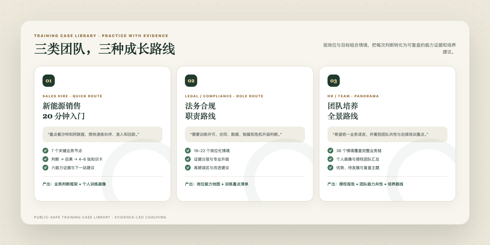

# GulfGate — مساعد تدريب الحكم في الأعمال الخارجية

<p><a href="README.md"><u>简体中文</u></a> · <a href="README.en.md"><u>English</u></a> · <a href="README.ar.md"><u>العربية</u></a></p>

<div align="center">
  
</div>

> يتدرب الموظف الجديد في الأعمال الخارجية داخل سيناريوهات آمنة، ويرى عواقب قراره، ثم يبدأ العمل مع أدلة سلوكية قابلة للتتبع.

[](SKILL.md)
[](#مسارات-التدريب)
[](#الصوتيات-العربية)
[](tests/validate_package.py)

يدخل المتدرب سيناريو أعمال خليجيًا قابلًا للتفسير، ويتخذ قرارًا رئيسيًا واحدًا، ثم يرى العاقبة التجارية ويحصل على بطاقات معرفة مترابطة، ويبني أدلة من السلوك الملاحظ. وتوفر كل جلسة أساسًا ملموسًا للتدريب المهني وتطوير الدور.

مناسبة لـ:

- تأهيل الموظفين الجدد في المبيعات والمشروعات والقانون والامتثال والتسليم؛
- ملاحظة القدرات داخل مقابلات العمل باستخدام سيناريوهات؛
- فرق المبيعات التي تحول معرفة المنتج إلى قدرة على الحكم على العميل والشريك والمخاطر؛
- توحيد لغة العمل وحدود التصعيد وشروط التوقف داخل الشركة.

## جلسة واحدة وأربع نتائج ملموسة

- **تغذية راجعة فورية:** العاقبة التجارية والحكم الأساسي والخطوة الأفضل التالية؛
- **أدلة القدرات:** متابعة A1–A6 عبر المهارات التي أُظهرت أو تتطور أو ما زالت بحاجة لملاحظة؛
- **مسار مخصص:** دمج الدول والقطاعات والأدوار ومدة الجلسة تلقائيًا؛
- **تقرير تدريب:** مراجعة شخصية ونقاط قوة وموضوعات تطوير وخطة المرحلة التالية.

## ثلاث حالات تدريب متكررة

<div align="center">
  
</div>

1. **موظف مبيعات جديد في الطاقة المتجددة · مسار سريع 20 دقيقة:** بناء إطار عملي عبر زيارة العميل وفحص الشريك والوصول والتحصيل.
2. **دور قانوني أو امتثال · مسار وظيفي:** التدريب على الأدلة والتصعيد والحكم المهني في الترخيص والعقود والبيانات والعقوبات والأزمات.
3. **الموارد البشرية أو تطوير الفريق · مسار شامل:** إكمال ملفات الوحدات وتحديد موضوعات التطوير المشتركة وإعداد تقرير تدريب معتمد.

## عرض توضيحي

<div align="center">
  
</div>

مثال على الطلب:

```text
استخدم $gulfgate-country-training.
أنا موظف جديد في مبيعات الطاقة المتجددة، وأركز على السعودية والإمارات.
أريد التدرب على تقييم الشركاء والوصول التنظيمي ومخاطر التحصيل في مسار سريع مدته 20 دقيقة.
```

راجع التفاعل الكامل في [examples/training-demo.md](examples/training-demo.md).

## ست قدرات

| القدرة | محور التدريب |
| --- | --- |
| A1 الحكم على الدولة | الدولة والإمارة والمنطقة الحرة والنطاق التنظيمي للمشروع وحداثة المعلومات |
| A2 التواصل بين الثقافات | العلاقات والسياق والتعريفات والاجتماعات وإشارات التقدم |
| A3 الحكم على الوصول | منتج، شركة، مشروع، منصة، ومؤهل مورد كطبقات منفصلة |
| A4 الوعي بالامتثال | التراخيص ومكافحة الفساد والضرائب والبيانات وحدود التوظيف |
| A5 حوكمة المخاطر | تصميم الأدلة وبوابات المراحل والتصعيد وشروط الانسحاب |
| A6 تنفيذ التسليم | عرض السعر والعقد واللوجستيات والتركيب والقبول والتحصيل كسلسلة واحدة |

يركز التقييم على الأدلة الفعالة E2 والقوية E3 عبر OBSERVE وREASON وDECIDE وACT وVERIFY وESCALATE وREVISE، ليعكس الحكم والتفكير والتنفيذ الشخصي للمتدرب.

## مسارات التدريب

| المسار | عدد السيناريوهات | الاستخدام |
| --- | ---: | --- |
| `quick` | 7 | مقدمة أو تدريب سريع للفريق في نحو 20 دقيقة |
| `role` | 18–28 | مسار مخصص حسب المبيعات أو القانون أو المشروعات أو الامتثال |
| `panorama` | 38 | استعراض كامل لسلسلة الأعمال |

تغطي الوحدات السبع الفرص السوقية والمنظومة التجارية والتواصل الثقافي والوصول والمناقصات والعقود والتحصيل والتسليم والعمليات المحلية والامتثال وإدارة الأزمات.

## التثبيت

```bash
git clone https://github.com/origami3521905038-hash/gulfgate-country-training.git
mkdir -p ~/.codex/skills
cp -R gulfgate-country-training ~/.codex/skills/
```

انسخ الحزمة كاملة. تتضمن الحزمة قواعد التدريب و33 ملفًا معرفيًا والفهرس والمصطلحات والملفات الصوتية.

## الصوتيات العربية

تتضمن الحزمة 379 مدخلًا عربيًا و369 ملف MP3 تغطي التحيات والضيافة والأعمال والامتثال والمصطلحات القطاعية.

يدعم المشغل تجميع مفردات الجلسة وتصفية المكتبة الكاملة وتشغيل كل كلمة بصورة مستقلة، مع إبقاء الصوت منفصلًا عن تقدم التدريب والملاحظات وملفات المتدربين.

## أدلة الاختبار

<div align="center">
  
</div>

يتحقق اختبار الإصدار من الترويسة والروابط المحلية و33 ملفًا معرفيًا و1,931 سجلًا مفهرسًا و379 مسارًا صوتيًا وقيم SHA-256 و369 ملف MP3، إضافة إلى اختبار البحث المحلي. يشغل GitHub Actions الاختبار نفسه عند كل دفعة وطلب دمج.

تجري إعادة تحقق تلقائية عند كل تحديث لفهارس المعرفة ومسارات الصوت وقيم التجزئة وأدوات البحث، بما يحفظ اتساق مواد التدريب وإصدار النشر.

## الخصوصية

- تبقى الملاحظات الشخصية خاصة افتراضيًا وتتبع نطاق إذن المستخدم.
- تدعم تقارير الموارد البشرية والفريق إذنًا صريحًا وضبطًا لنطاق البيانات.
- يُؤكد حفظ التقدم بعد نجاح عملية التخزين لضمان موثوقية سجلات المراجعة.
- يحافظ وضع الدردشة فقط على التقدم داخل السياق الحالي.
- تبقى الملاحظات والإجابات وملفات المتدربين منفصلة عن ملفات المهارة القابلة للتوزيع.

## التحقق في الوقت الفعلي

عندما يتضمن التدريب عروض أسعار أو مناقصات أو شحنًا أو تخليصًا أو انتقالًا أو ضرائب أو منتجات طبية أو سلامة منتجات أو بيانات عبر الحدود أو عقوبات، ينتقل سير العمل إلى LIVE_VERIFY ويستند إلى الجهة المختصة والنص الرسمي.

عند توفر أدوات البحث وقراءة الصفحات في المضيف يمكن إجراء التحقق الحي، بينما تدعم قاعدة المعرفة المرفقة سياق السيناريو والتحليل التجاري وقوائم الأدلة.

## المشروع المرافق

لمهام البحث الفعلية والتخطيط لدخول السوق والفحص قبل اتخاذ الإجراء، استخدم [GulfGate Country Analysis](https://github.com/origami3521905038-hash/gulfgate-country-analysis).

## المشاركون في الإنشاء

أُنجز هذا المشروع بالتعاون بين [@origami3521905038-hash](https://github.com/origami3521905038-hash) و[@18719203981lkr-spec](https://github.com/18719203981lkr-spec) و[@konczgrignani409-blip](https://github.com/konczgrignani409-blip) و[@yao132517-byte](https://github.com/yao132517-byte) و[@m17783458051-tutu](https://github.com/m17783458051-tutu).

راجع [CONTRIBUTORS.md](CONTRIBUTORS.md) لسجل الإسناد الكامل. نرحب بالمساهمات عبر Issues وPull Requests. راجع [CONTRIBUTING.md](CONTRIBUTING.md).

## الترخيص

حقوق النشر مشتركة بين المشاركين في إنشاء المشروع. يمكن التواصل مع المؤلفين لمناقشة تدريب المؤسسات والدورات المخصصة والتوسع القطاعي وتراخيص الشراكة.

