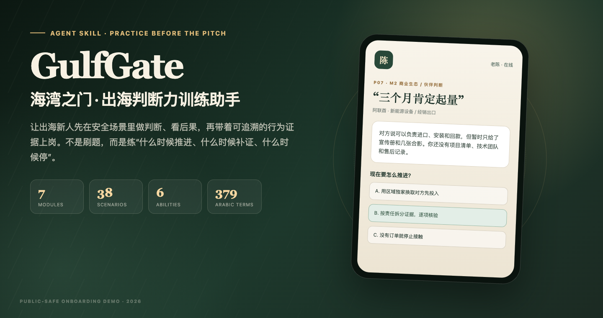
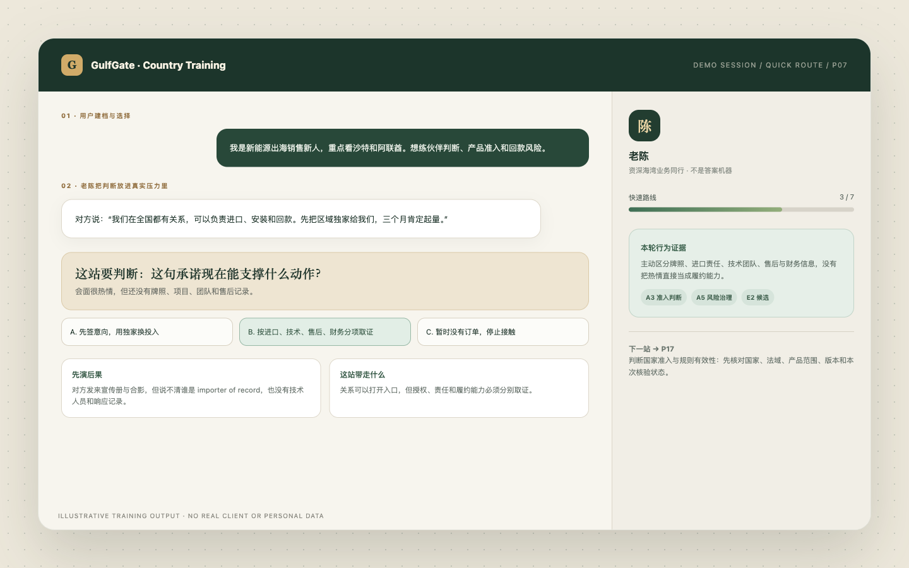
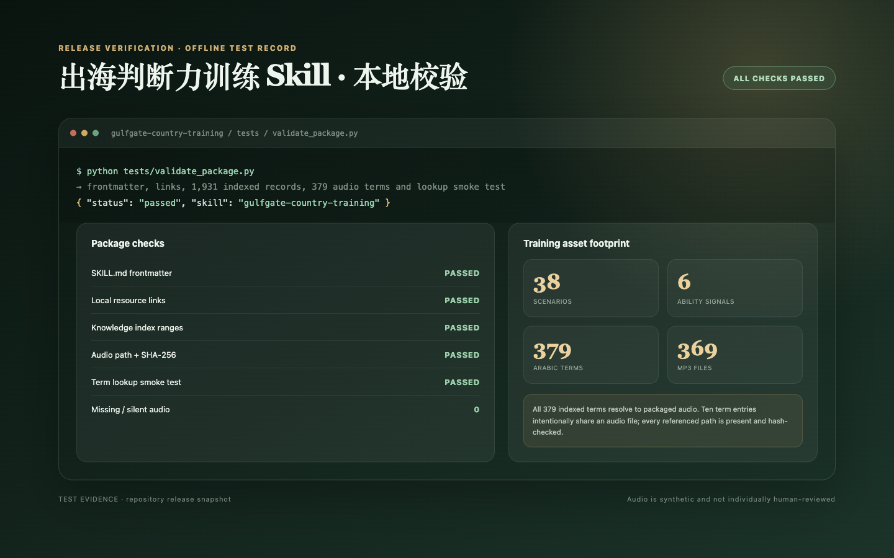

# GulfGate — مساعد تدريب الحكم في الأعمال الخارجية

[简体中文](README.md) · [English](README.en.md) · [العربية](README.ar.md)

<div align="center">
  
</div>

> يتدرب الموظف الجديد في الأعمال الخارجية داخل سيناريوهات آمنة، ويرى عواقب قراره، ثم يبدأ العمل مع أدلة سلوكية قابلة للتتبع.

[](SKILL.md)
[](#مسارات-التدريب)
[](#الصوتيات-العربية)
[](tests/validate_package.py)

هذه ليست أداة اختبار تعتمد على النقاط، ولا مجموعة أسئلة لحفظ إجابة واحدة. يدخل المتدرب سيناريو أعمال خليجيًا قابلًا للتفسير، ويتخذ قرارًا رئيسيًا واحدًا، ثم يرى العاقبة ويحصل على بطاقات معرفة مترابطة، ولا تُسجل الأدلة إلا من السلوك الملاحظ.

مناسبة لـ:

- تأهيل الموظفين الجدد في المبيعات والمشروعات والقانون والامتثال والتسليم؛
- ملاحظة القدرات داخل مقابلات العمل باستخدام سيناريوهات؛
- تدريب مندوب يعرف المنتج لكنه لا يجيد الحكم على العميل أو الشريك أو المخاطر؛
- توحيد لغة العمل وحدود التصعيد وشروط التوقف داخل الشركة.

## عرض توضيحي

<div align="center">
  
</div>

مثال على الطلب:

```text
استخدم $gulfgate-country-training.
أنا موظف جديد في مبيعات الطاقة المتجددة، وأركز على السعودية والإمارات.
أريد التدرب على تقييم الشركاء والوصول التنظيمي ومخاطر التحصيل في مسار سريع مدته 20 دقيقة.
```

راجع التفاعل الكامل في [examples/training-demo.md](examples/training-demo.md).

## ست قدرات

| القدرة | محور التدريب |
| --- | --- |
| A1 الحكم على الدولة | الدولة والإمارة والمنطقة الحرة والنطاق التنظيمي للمشروع وحداثة المعلومات |
| A2 التواصل بين الثقافات | العلاقات والسياق والتعريفات والاجتماعات وإشارات التقدم |
| A3 الحكم على الوصول | منتج، شركة، مشروع، منصة، ومؤهل مورد كطبقات منفصلة |
| A4 الوعي بالامتثال | التراخيص ومكافحة الفساد والضرائب والبيانات وحدود التوظيف |
| A5 حوكمة المخاطر | تصميم الأدلة وبوابات المراحل والتصعيد وشروط الانسحاب |
| A6 تنفيذ التسليم | عرض السعر والعقد واللوجستيات والتركيب والقبول والتحصيل كسلسلة واحدة |

تتراوح الأدلة بين E0، أي عدم الملاحظة، وE3، أي دليل قوي يتضمن معالجة التعارض وحدود التحقق والمراجعة عند ظهور دليل جديد. لا تُحسب الأسباب المضمنة في خيارات الإجابة كتفكير مستقل للمتدرب.

## مسارات التدريب

| المسار | عدد السيناريوهات | الاستخدام |
| --- | ---: | --- |
| `quick` | 7 | مقدمة أو تدريب سريع للفريق في نحو 20 دقيقة |
| `role` | 18–28 | مسار مخصص حسب المبيعات أو القانون أو المشروعات أو الامتثال |
| `panorama` | 38 | استعراض كامل لسلسلة الأعمال |

تغطي الوحدات السبع الفرص السوقية والمنظومة التجارية والتواصل الثقافي والوصول والمناقصات والعقود والتحصيل والتسليم والعمليات المحلية والامتثال وإدارة الأزمات.

## التثبيت

```bash
git clone https://github.com/origami3521905038-hash/gulfgate-country-training.git
mkdir -p ~/.codex/skills
cp -R gulfgate-country-training ~/.codex/skills/
```

انسخ الحزمة كاملة. تتضمن الحزمة قواعد التدريب و33 ملفًا معرفيًا والفهرس والمصطلحات والملفات الصوتية.

## الصوتيات العربية

تتضمن الحزمة 379 مدخلًا عربيًا و369 ملف MP3 تغطي التحيات والضيافة والأعمال والامتثال والمصطلحات القطاعية.

الصوت مُنشأ آليًا بصوت Majed من macOS، وليس تسجيلًا بشريًا. جميع المدخلات ما زالت مصنفة بأنها غير مراجعة فرديًا بشريًا، ولا يدعي المشروع خلوها من الأخطاء.

## أدلة الاختبار

<div align="center">
  
</div>

يتحقق اختبار الإصدار من الترويسة والروابط المحلية و33 ملفًا معرفيًا و1,931 سجلًا مفهرسًا و379 مسارًا صوتيًا وقيم SHA-256 و369 ملف MP3، إضافة إلى اختبار البحث المحلي. يشغل GitHub Actions الاختبار نفسه عند كل دفعة وطلب دمج.

نجاح الاختبار يثبت سلامة الحزمة واتساق الأصول، ولا يمثل دراسة واسعة النطاق لفعالية التدريب.

## الخصوصية

- الملاحظات الشخصية خاصة افتراضيًا.
- تقارير الموارد البشرية أو الفريق تتطلب إذنًا صريحًا.
- لا يجوز وصف التقدم بأنه محفوظ إلا بعد نجاح عملية التخزين.
- لا يجوز كتابة الملاحظات أو الإجابات أو ملفات المتدربين داخل ملفات المهارة القابلة للتوزيع.

## حدود الاستخدام

القواعد والسياسات داخل السيناريوهات مواد تدريبية فقط. أسئلة عروض الأسعار والمناقصات والشحن والتخليص والانتقال والأعمال الضريبية والطبية وسلامة المنتجات وبيانات عبر الحدود والعقوبات تتطلب تحققًا حيًا من المصادر الرسمية الحالية.

## المشروع المرافق

لمهام البحث الفعلية والتخطيط لدخول السوق والفحص قبل اتخاذ الإجراء، استخدم [GulfGate Country Analysis](https://github.com/origami3521905038-hash/gulfgate-country-analysis).

## المشاركون في الإنشاء

أُنجز هذا المشروع بالتعاون بين [@origami3521905038-hash](https://github.com/origami3521905038-hash) و[@18719203981lkr-spec](https://github.com/18719203981lkr-spec).

نرحب بالمساهمات عبر Issues وPull Requests. راجع [CONTRIBUTING.md](CONTRIBUTING.md).

## الترخيص

لا يوجد ترخيص مفتوح مرفق حتى الآن. تبقى حقوق النشر للمشاركين في إنشاء المشروع، ويلزم الحصول على إذن كتابي قبل إعادة الاستخدام العام أو الاستخدام التجاري أو إعادة التوزيع.

